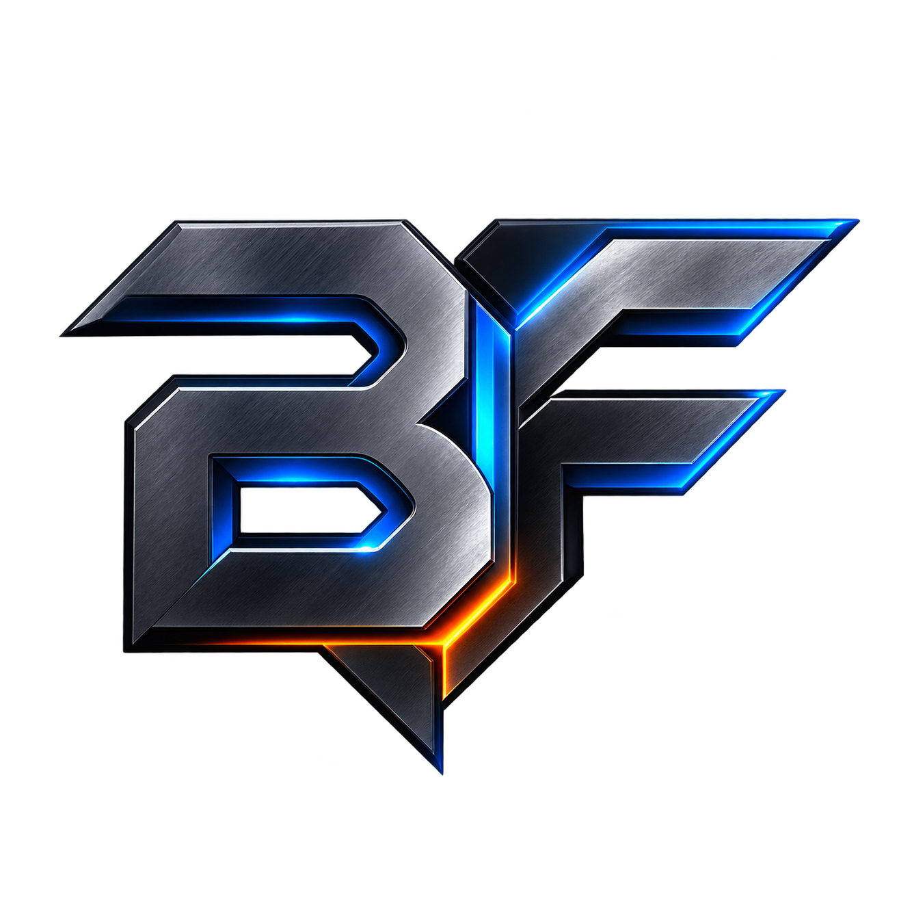

<p align="center">
  
</p>

<h1 align="center">BasicForge</h1>

<p align="center">
  <strong>FORGE YOUR CODE. BUILD NATIVE.</strong>
</p>

<p align="center">
  A Visual Basic-inspired programming language, native Windows compiler,
  and dedicated visual development environment.
</p>

<p align="center">
  
  
  
  
</p>

<p align="center">
  
  
</p>

<p align="center">
  <a href="#overview">Overview</a> •
  <a href="#features">Features</a> •
  <a href="#quick-start">Quick Start</a> •
  <a href="#language-preview">Language</a> •
  <a href="#architecture">Architecture</a> •
  <a href="#documentation">Documentation</a> •
  <a href="#license">License</a>
</p>

---

## Forge Your Own Way

**BasicForge** is an independent programming language and Windows development ecosystem inspired by the clarity and approachability of Visual Basic 6 and VB.NET.

Its goal is to bring an expressive, approachable language together with a purpose-built compiler, a native Windows toolchain, and an integrated visual development environment.

BasicForge has its own lexer, parser, semantic analysis, language-owned intermediate representation (BFIR), and code-generation pipeline. It is not simply a syntax skin over Visual Basic, nor is it a wrapper around an existing language compiler.

> **One language. Its own compiler. A dedicated IDE. Native Windows applications.**

## Overview

| Area | Technology / Target |
|---|---|
| Language | BasicForge (`.bf`) — Visual Basic-inspired syntax |
| Compiler implementation | C++ |
| IDE implementation | Rust |
| Compiler IR | BasicForge Intermediate Representation (BFIR) |
| Default code-generation route | BasicForge → C source → Clang → COFF object → LLD linker |
| Optional code-generation route | BasicForge IR → LLVM IR → LLVM code generation |
| Executable format | Windows PE32+ |
| Initial platform | Windows 10/11, x64 |
| GUI technology | Native Win32 forms; Rust desktop IDE |

## Features

### Language and compiler

- Case-insensitive, strongly typed, Visual Basic-inspired syntax.
- Dedicated lexer, parser, semantic analysis, symbol resolution, and type checking.
- A language-owned intermediate representation (BFIR), independent of either backend.
- Variables, primitive types, type inference, expressions, and conversions.
- Conditional statements, loops, `Select Case`, procedures, and functions.
- Modules, classes, fields, properties, constructors, and method calls.
- Arrays, string operations, interpolation, and standard-library modules.
- Multi-file source inclusion with recursive, cycle-safe, deduplicated `Include` handling.
- Compiler diagnostics and command-line workflows.

### Native Windows output

- Generates Windows x64 PE32+ executables.
- Supports console and GUI application targets.
- Supports static-library and shared-library targets.
- Uses Clang and LLD in the default toolchain route.
- Offers an optional direct LLVM C++ backend when the required LLVM development headers and libraries are available.

### Visual forms and controls

BasicForge form declarations describe native Win32 windows and controls in the language. The IDE Form Designer can generate the corresponding BasicForge form syntax.

The project currently documents support for these **20 controls**:

1. Button
2. Label
3. TextBox
4. CheckBox
5. RadioButton
6. GroupBox
7. Panel
8. PictureBox
9. ListBox
10. ComboBox
11. TrackBar
12. ProgressBar
13. DateTimePicker
14. ListView
15. TreeView
16. RichTextBox
17. TabControl
18. ToolBar
19. StatusBar
20. UpDown

Form events include click, double-click, text change, selection change, value change, focus, keyboard, mouse, scrolling, painting, and drag-and-drop event hooks as implemented by the form pipeline. `GetText("controlName")` and `SetText("controlName", value)` provide named-control text access.

### IDE and developer tools

- Rust-based desktop IDE.
- Code editor with syntax highlighting and completion support.
- Diagnostics, hover information, and symbol navigation.
- Project and source-file management.
- Visual Form Designer with toolbox and property editing.
- Debugger interface and native `bfc debug` command-line workflow.
- Language Server Protocol (LSP) mode for editor integration.

### Standard library and SDKs

The repository includes BasicForge standard-library modules for mathematics, strings, arrays, files, dates, console operations, JSON, CSV, validation, random values, and related utilities. Win32 and other helper modules are available under `sdks/` and `libraries/`.

## Language Preview

A small example of the BasicForge syntax:

```vb
Module Main
    Sub Main()
        Dim language As String = "BasicForge"
        Dim first As Integer = 20
        Dim second As Integer = 22

        Print("Hello from " & language)
        Print(first + second)
    End Sub
End Module
```

### Classes

```vb
Module Main
    Class Person
        Public Name As String
        Public Age As Integer

        Public Sub New(name As String, age As Integer)
            Me.Name = name
            Me.Age = age
        End Sub

        Public Function GetInfo() As String
            Return Me.Name & " is " & CStr(Me.Age)
        End Function
    End Class

    Sub Main()
        Dim person As New Person("Alice", 30)
        Print(person.GetInfo())
    End Sub
End Module
```

### Native Windows form declaration

```vb
Module Main
    Form MainForm
        Width = 640
        Height = 480
        Text = "My BasicForge App"

        Button btnOK
            Text = "OK"
            Left = 20
            Top = 20
            Width = 100
            Height = 32
            OnClick = btnOK_Click
        End Button
    End Form

    Sub Main()
        ' Application entry point
    End Sub

    Sub btnOK_Click()
        Print("Button clicked")
    End Sub
End Module
```

For the complete and authoritative language details, see the [Language Reference](docs/LANGUAGE_REFERENCE.md) and [Language Specification](LANGUAGE_SPECIFICATION.md).

## Architecture

BasicForge separates its language frontend and BFIR from the code-generation backends. Both backend routes consume the same language pipeline; they are alternative ways to turn the compiler's intermediate representation into native Windows output.

```text
                         BasicForge source (.bf)
                                   │
                                   ▼
                    Lexer → Parser → Semantic Analysis
                                   │
                                   ▼
                         BasicForge IR (BFIR)
                                   │
                     ┌─────────────┴─────────────┐
                     │                           │
                     ▼                           ▼
              Default backend              Optional backend
                C emission                  LLVM C++ API
                     │                           │
                     ▼                           ▼
              Generated C source                LLVM IR
                     │                           │
                     ▼                           ▼
                clang -O2                 LLVM optimization
                     │                           │
                     ▼                           ▼
                COFF object               LLVM native codegen
                     │                           │
                     └─────────────┬─────────────┘
                                   ▼
                              LLD linker
                                   │
                                   ▼
                          Windows PE32+ output
```

**Default backend:** the standard build uses the C-emission route: BasicForge code is lowered through BFIR, emitted as C, compiled by Clang, and linked by `lld-link`.

**Optional LLVM backend:** when the LLVM development headers and libraries are detected and the corresponding build option is enabled, the compiler can use its direct LLVM C++ code-generation path. This is an alternative backend, not a separate language frontend.

For implementation details and design decisions, see [ARCHITECTURE.md](ARCHITECTURE.md) and [Architecture Decision Records](ARCHITECTURE_DECISIONS/).

## Runtime and Deployment

BasicForge-generated applications do **not** require the BasicForge IDE, the `bfc` compiler, or LLVM/Clang/LLD to be installed on the target computer merely to run the generated program.

This does not mean every generated executable is guaranteed to be independent of every operating-system component or runtime library. Depending on the selected target and the features used by an application, the linker may include or reference Windows system libraries and Microsoft C/C++ runtime components. Windows system DLLs and any required redistributable runtime components remain separate from the BasicForge compiler itself.

In short: **there is no separate BasicForge virtual machine or mandatory BasicForge application runtime to install**, while ordinary Windows and toolchain runtime dependencies still depend on the produced binary.

## Quick Start

### Requirements for building from source

- Windows 10 or Windows 11, x64.
- CMake 3.20 or newer.
- Ninja (when using the Ninja generator).
- A compatible C++ toolchain, such as Visual Studio 2022 C++ Build Tools or clang-cl.
- Windows 10/11 SDK.
- LLVM/Clang toolchain providing `clang.exe` and `lld-link.exe`.
- Rust toolchain (`rustc` and `cargo`) to build the IDE.

These are **development/build requirements**. They should not be confused with the requirements for running a BasicForge-generated application.

### Build the compiler

From the repository root:

```powershell
cmake -S compiler -B build/compiler -G Ninja `
  -DCMAKE_BUILD_TYPE=Release `
  -DBFC_BUILD_TESTS=ON

cmake --build build/compiler --config Release
```

The resulting compiler executable is produced in the configured build directory. If LLVM is not discoverable automatically, configure the LLVM location using the CMake options documented in [Building](BUILDING.md) and [SDK setup](sdks/README.md).

### Build the IDE

```powershell
cd ide
cargo build --release
```

### Run tests

```powershell
ctest --test-dir build/compiler -C Release --output-on-failure
```

The compiler test scripts and additional test instructions are documented in [BUILDING.md](BUILDING.md) and the compiler test directories.

### Compile and run a program

```powershell
bfc.exe examples\HelloWorld.bf -o HelloWorld.exe
.\HelloWorld.exe
```

### Select an output target

```powershell
bfc.exe app.bf -o app.exe --target console
bfc.exe app.bf -o app.exe --target gui
bfc.exe lib.bf -o lib.lib --target staticlib
bfc.exe lib.bf -o lib.dll --target sharedlib
```

The compiler CLI and its available commands are described in the [User Guide](docs/USER_GUIDE.md).

## Language Server and Debugger

The compiler provides an LSP mode over standard input/output. The IDE can launch this mode for language-service communication. Supported functionality documented by the project includes initialization, document lifecycle notifications, diagnostics, completion, hover, and go-to-definition.

Example editor configuration:

```json
{
  "command": "C:\\Path\\To\\BasicForge\\bfc.exe",
  "args": ["--lsp"]
}
```

The debugger is available through the compiler CLI and the IDE debugger panel. Its documented workflows include breakpoints, continue, stepping, registers, backtrace/call-stack inspection, and disassembly support.

## Repository Layout

```text
BasicForge/
├── .github/                 # CI, documentation, lint and release workflows
├── compiler/                # C++ compiler, frontend, BFIR and backends
├── ide/                     # Rust desktop IDE
├── runtime/                 # Compiler/runtime support code
├── libraries/               # BasicForge standard-library modules
├── sdks/                    # LLVM and platform/helper SDK material
├── examples/                # BasicForge example programs
├── docs/                    # User, language, IDE and debugger documentation
├── tests/                   # Test suites and test support
├── ARCHITECTURE_DECISIONS/  # Architecture Decision Records
├── ARCHITECTURE.md          # Compiler and IDE architecture
├── LANGUAGE_SPECIFICATION.md# Formal language specification
├── DEPENDENCIES.md          # Dependency registry
├── THIRD_PARTY_NOTICES.md   # Third-party attributions
├── LICENSE                 # BasicForge project license
└── README.md                # Project overview
```

## Dependencies and Third-Party Notices

The compiler toolchain uses LLVM/Clang and LLD. The IDE uses Rust crates including egui/eframe and supporting crates. The repository also documents tools and libraries evaluated as possible future components; **evaluated does not mean integrated**.

For current integration status, versions, license details, and required notices, consult:

- [DEPENDENCIES.md](DEPENDENCIES.md)
- [THIRD_PARTY_NOTICES.md](THIRD_PARTY_NOTICES.md)
- [DEPENDENCY_LICENSES.md](DEPENDENCY_LICENSES.md)

Third-party components remain under their own respective licenses. The BasicForge project license does not replace or override those licenses.

## Project Status

BasicForge is under active development. Version `0.1.0` represents an early project milestone, not a claim that every planned language, IDE, or toolchain feature is complete. Feature availability and limitations are documented in the language reference, user guide, changelog, and release notes.

Contributions, redistribution, and other use of the BasicForge source are governed by the repository's [LICENSE](LICENSE). Please read it before using or reusing the project.

## Documentation

| Document | Description |
|---|---|
| [User Guide](docs/USER_GUIDE.md) | Setup, first program, compiler CLI and IDE |
| [Language Reference](docs/LANGUAGE_REFERENCE.md) | Syntax, types, statements, classes and forms |
| [Language Specification](LANGUAGE_SPECIFICATION.md) | Formal language design and rules |
| [IDE Guide](docs/IDE_GUIDE.md) | Editor, projects, designer and debugger |
| [Debugger Guide](docs/DEBUGGER_GUIDE.md) | Debugger commands and examples |
| [Standard Library](docs/STDLIB.md) | Standard-library modules |
| [Examples](docs/EXAMPLES.md) | Example programs |
| [Architecture](ARCHITECTURE.md) | Compiler and IDE design |
| [Changelog](CHANGELOG.md) | Project changes |
| [Building](BUILDING.md) | Build requirements and instructions |

## License

BasicForge's original source code and project materials are distributed under the **Proprietary Source-Available License** included in [`LICENSE`](LICENSE). It is **not** an MIT-licensed or open-source project license. Viewing and study are permitted under the terms stated in that file; commercial use, redistribution, and distribution of modified versions require prior written authorization as specified by the license.

Third-party dependencies are governed by their respective licenses and notices. See [THIRD_PARTY_NOTICES.md](THIRD_PARTY_NOTICES.md) and [DEPENDENCY_LICENSES.md](DEPENDENCY_LICENSES.md).

---

<p align="center">
  <strong>BasicForge — Forge Your Code. Build Native.</strong>
</p>
